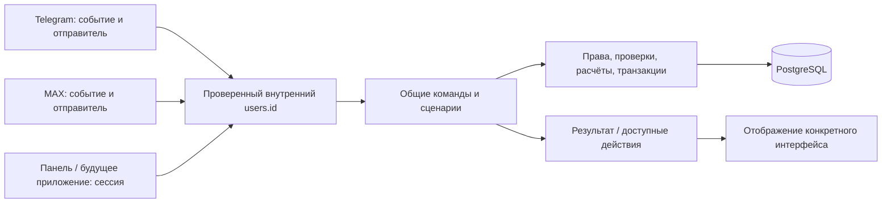

# Общее прикладное ядро

28.10.2026 · ветка `refactor/shared-application-core`.

Ядро — функции сценариев и бизнес-правил, которые вызывают интерфейсы. Это общий
Python-код внутри процессов Telegram, MAX и веб-панели. Для его выделения не нужен
отдельный HTTP API, сервер или контейнер.

## Границы



В адаптерах остаются проверка отправителя/сессии, декодирование платформенных
событий, скачивание файлов, HTTP/CSRF, создание кнопок SDK и отправка сообщений.
В ядре находятся проверка текущих прав и компании, допустимость операций,
переходы сценариев, защита повторов и финансовой истории, расчёт и сохранение.
Роль или company_id из нажатой кнопки не заменяют проверку в БД.

## Точки вызова

| Сценарий | Общая реализация | Адаптеры |
|---|---|---|
| Компании, проекты, сотрудники, приглашения, настройки | `application/workspace.py`: `WorkspaceCommands.execute/input` | Telegram `handlers/workspace.py`, MAX `max_bot/workspace.py` |
| Пошаговая выдача денег | `application/issue.py`: `IssueCommands.apply`; `services/advance_issue_flow.py` | Telegram `handlers/issue.py`, MAX `max_bot/issue.py` |
| Фото/PDF → распознавание → проверка → проект → сохранение | `services/document_flow.py`: `DocumentFlow` | Telegram/MAX адаптеры документов |
| Создание/изменение сущностей из готовой формы | `services/workspace.py`: `WorkspaceService` | Общие команды, документы и веб-панель |
| Выдача, получение, привязка расхода, возврат, отмена | `services/advances.py`: `AdvanceService` | Команды выдачи, Telegram, MAX, веб (с учётом доступных экранов) |
| Бизнес-карты и привязки документов | `services/business_cards.py`: `BusinessCardService` | Telegram и веб; готово для другого интерфейса |
| Отчёты, документы, XLSX, решения по дублям | `services/reporting.py`: `ReportService` | Telegram и веб; общий сервис без зависимости от клиента |
| Денежные отчёты | `services/money_reports.py` | Telegram/MAX, панель и выгрузки |
| Вступление по коду | `services/company_invitations.py`: `CompanyInvitations` | Telegram и MAX onboarding |
| Привязка аккаунтов | `services/account_links.py`: `AccountLinkService` | Telegram и MAX |
| ИИ-отчёты | `services/ai_reports.py`, `ai_report_engine.py` | Telegram и MAX; общий диалог `application/ai_reports.py` |

Готовая веб-форма передаёт поля сразу в общий сервис операции. Мессенджер получает
поля последовательно через общий сценарий. Оба пути заканчиваются одними
проверками и транзакциями. Веб не обязан изображать диалог выбора кнопок бота.

## Пример без Telegram, MAX и HTTP

```python
from app.application.workspace import WorkspaceCommands, WorkspaceCommand
from app.application.issue import IssueCommands

# actor уже получен из доверенного адаптера аутентификации; это users.id.
workspace = WorkspaceCommands()
view = await workspace.execute(actor, WorkspaceCommand('create_project'))
view = await workspace.input(actor, 'Ривер Дон', 'unique-event-id', platform='web')

issue = IssueCommands()
view = await issue.apply(actor, 'web', 'event-1', 'start')
# Дальше employee/project/text/skip_purpose/confirm с текущим draft_id.
```

Для готовой формы можно вызвать `WorkspaceService.create_project(actor, name)`
или `AdvanceService.issue(...)`. Не копировать из сервиса проверку роли,
существования проекта/сотрудника, денег или ограничений архивации.

`View` содержит текст и строки действий `Action(label, command)`. Это обычные
Python-значения, без `Message`, `CallbackQuery`, MAX update или HTTP Request.
Адаптер преобразует действие в callback своей платформы. Существующие callback
ID поддерживаются; длинное назначение с BIGINT в Telegram получает компактный
вариант в пределах 64 байт. Действия не несут полномочия пользователя.

`WorkspaceCommands.handle` — совместимый декодер строк команд; новый клиент
может вызывать `execute` и `input`, не формируя `/команду`.

## Общие черновики

Создание компании, создание/переименование проекта и выдача привязаны к
каноническому пользователю. Начать в Telegram и продолжить в MAX можно после
подтверждённой привязки аккаунтов. Второй интерфейс не создаёт копию черновика.

- Ввод живёт 15 минут и хранится в PostgreSQL, переживая перезапуск процесса.
- Новый сценарий администрирования/выдачи отменяет предыдущий ввод этих типов.
- `/cancel` Telegram отменяет и начатый через MAX ввод этих типов.
- Права и исходная компания проверяются повторно перед изменением данных.
- Повторные события учитывают платформу; одинаковые внешние ID не конфликтуют.
- Подтверждение выдачи из двух интерфейсов создаёт одну выплату и одно событие.
- Ошибка названия или записи не поглощает черновик: значение можно повторить.
- В Telegram теперь тот же путь выдачи: сотрудник → проект → сумма → необязательное
  назначение → подтверждение. Сумма и назначение вводятся отдельными шагами.

Черновик документа отдельно управляется `DocumentFlow`. Формы возврата,
причины решения и регистрации карты в старом Telegram-интерфейсе пока используют
его `pending_actions`: финансовое действие выполняет общий сервис, но эти формы
ещё не перенесены на общий многошаговый контроллер. Поэтому нельзя объявлять
**все** состояния всех интерфейсов единым универсальным диалогом.

## Отчёты и дубли

`ReportService` используется панелью и Telegram-проекцией `ViewService`.
Отдельные SQL-расчёты Telegram-отчётов удалены. Общая сводка считает RUB отдельно
от других валют, включает документы бывших сотрудников и архивных проектов,
не суммирует повторно документ и его привязку к источнику оплаты. XLSX Telegram
вызывает тот же экспорт, что и панель. Период — дата загрузки, UTC.

Удаление исходника/дубля выполняется одним методом с одинаковой проверкой
финансовых связей и блокировками. Telegram больше не имеет отдельного пути,
который удаляет документ с финансовой историей.

ИИ-отчёт остаётся отдельным типизированным построителем SQL-выборок, поскольку
поддерживает другие группировки и основания дат. Его бизнес-показатели используют
те же данные; это не второй мессенджерный бэкенд.

## Обновление и миграция 023

1. Сделать резервную копию рабочей БД.
2. Собрать новую версию Telegram, MAX и веб-панели, если она запущена.
3. Остановить старые процессы этих адаптеров.
4. Запустить все используемые адаптеры из одной новой версии.

Миграция `023_shared_application_flows.sql` выполняется штатным мигратором:

- переименовывает `max_workspace_flows` в `workspace_flows`;
- оставляет совместимое SQL-представление со старым именем;
- переносит живой Telegram-ввод компании/проекта и суммы выдачи;
- сохраняет уже созданные документы, выплаты и идемпотентность MAX;
- при конкурирующих вводах оставляет один актуальный сценарий.

Не удалять том PostgreSQL, не менять Compose project и не очищать `.env`.
Эта ветка сама по себе не обновляет VPS.

## Проверки и дальнейшие изменения

Полный прогон: 393 теста успешно; профильный набор ядра: 20 тестов успешно.
Внешние API в автотестах подменяются; VPS здесь не проверяется.

`tests/test_application_core.py` проверяет запуск без SDK/веб-фреймворков,
переходы между платформами, атомарность компании и приглашения, повторные
подтверждения денег, старые/чужие кнопки, перенос черновиков, согласованность
отчётов и реальную маршрутизацию Telegram.

Новый бизнес-сценарий сначала реализуется в общем сервисе/команде и проверяется
через канонический user_id. После этого добавляются декодер события и рендер
интерфейса. Если для изменения правила приходится исправлять одновременно
`handlers` и `max_bot`, это повод проверить границу ядра.
