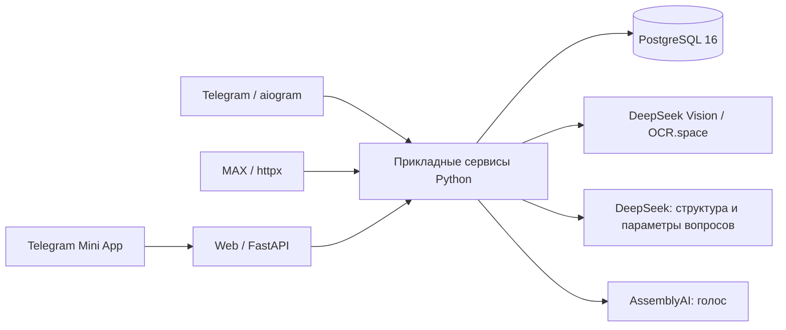
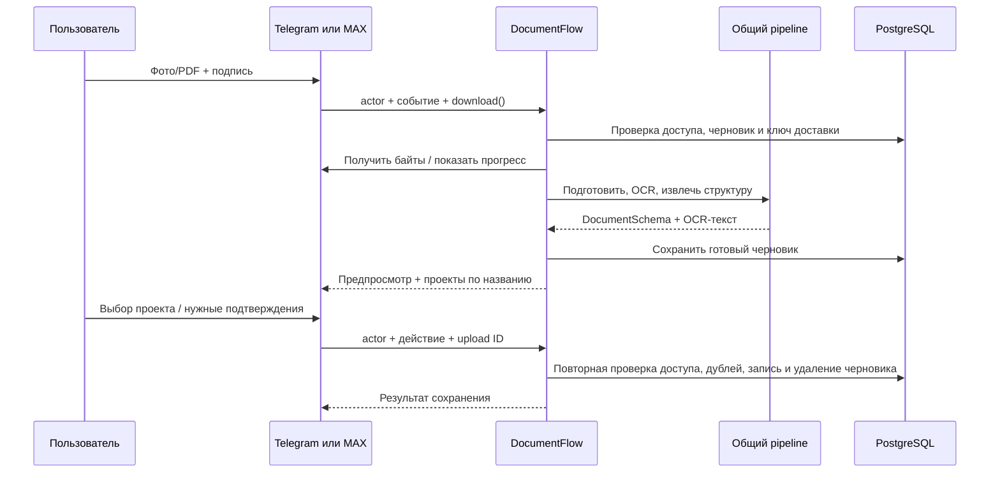
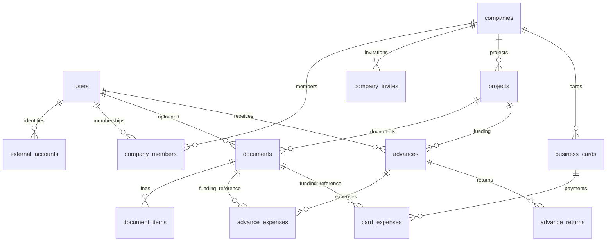

# FIINOPS: архитектура и карта кода

Версия 1.1 · 28.10.2026 · исходный срез `69c2842` + `refactor/shared-application-core`.
Описание продукта — [PRODUCT.md](PRODUCT.md), требования —
[TECHNICAL_SPECIFICATION.md](TECHNICAL_SPECIFICATION.md).

Контракты команд и миграция 023 — [APPLICATION_CORE.md](APPLICATION_CORE.md).

## 1. Архитектурная модель

Приложение разделено на адаптеры интерфейсов, прикладные сервисы, контракты
и PostgreSQL. Ядро — импортируемый Python-код, а не отдельный сетевой сервис.
В разных контейнерах находятся процессы адаптеров с одной версией этого кода.
Единые данные находятся в одной БД; отдельной базы на мессенджер нет.

Диаграмма показывает слои, а не одинаковую доступность всех функций из каждого
адаптера. ИИ-запросы и голос подключены в Telegram и MAX через общий `AIReportCommands`. Общее ядро документов
используется Telegram/MAX; веб-загрузки ещё нет.

Обязательная граница определена в [CORE_BOUNDARY_REQUIREMENTS.md](CORE_BOUNDARY_REQUIREMENTS.md).
Все модули `services`/`application` импортируются без SDK, UI и HTTP-фреймворка.
Telegram-совместимые сигнатуры вынесены в `app/adapters/telegram` и преобразуют
идентичность перед вызовом канонических сервисов. Фронты не выполняют SQL;
инициализация/закрытие БД разрешены только как управление жизненным циклом.
Идентичность и адреса доставки могут содержать внешние IDs, но бизнес-команда
принимает внутренний actor. Это проверяет `test_core_boundaries.py`.

## 2. Точки запуска и процессы

| Команда | Точка входа | Назначение |
|---|---|---|
| `python -m app.main` | `app/main.py` → `app/bot.py` | Telegram polling, маршруты, уведомления |
| `python -m app.max_bot --check` | `app/max_bot/__main__.py` | Проверка авторизации MAX и подписок, без polling |
| `python -m app.max_bot --poll-dev` | тот же модуль → `runner.py` | Тестовый MAX polling |
| `python -m app.web` | `app/web/__main__.py` | Uvicorn/FastAPI, панель и Mini App |

Все процессы подключают БД через `services/database.py`. При создании пула
применяются SQL-миграции под общей advisory-блокировкой. Текущий пул — min 1 / max 5
соединений на процесс; это не глобальный лимит всей установки.

MAX poller хранит курсор в БД и берёт блокировку экземпляра бота. Два poller
одного MAX-бота не должны работать одновременно. Telegram polling также нельзя
запускать параллельно для одного токена в облаке и на VPS. Боты разных платформ
могут работать одновременно с одной БД.

## 3. Карта модулей

| Область | Файлы / каталоги | Ответственность |
|---|---|---|
| Конфигурация | `app/config.py`, `app/web/config.py` | DB/боты/провайдеры/owner и настройки веба |
| Telegram | `app/handlers/`, `app/bot.py` | Аутентифицированные события, скачивание, сообщения, кнопки |
| MAX | `app/max_bot/` | HTTP Bot API, TLS, polling, callback, загрузки, представление |
| HTTP | `app/web/app.py`, `auth.py` | Валидация запросов, авторизация, вызов сервисов, ответы |
| UI | `app/ui/`, `app/web/static/` | Клавиатуры, текст карточек, браузерные экраны |
| Пользователи | `services/account_links.py`, `max_onboarding.py`, `membership.py` | Связанные аккаунты, вступление, текущие права |
| Администрирование | `services/workspace.py`, `workspace_flow.py` | Компании, проекты, сотрудники, аудит, ввод названий |
| Документы | `document_flow.py`, `document_drafts.py`, `documents.py` | Сценарий, состояние, проверки и запись |
| Распознавание | `document_processing.py`, `recognition.py`, `pdf_files.py`, `image_files.py`, `deepseek.py`, `ocr_space.py` | Подготовка, OCR/LLM, ограничения и очистка |
| Команды | `app/application/workspace.py`, `issue.py`, `views.py` | Общие сценарии, результаты и действия без SDK |
| Деньги | `advances.py`, `advance_issue_flow.py`, `business_cards.py` | Выдачи, получение, расходы, возвраты, карты |
| Отчёты | `money_reports.py`, `reporting.py`, `views.py`, `report_exports.py`, `report_formatters.py` | Выборки, сводки, формат и XLSX |
| ИИ-вопросы | `ai_reports.py`, `ai_report_engine.py`, `ai_report_catalog.py`, `ai_report_sessions.py`, `speech.py` | Разбор, разрешённые операции, контекст и STT |
| Доступ веба | `web_auth.py`, `telegram_mini_auth.py` | Одноразовое подтверждение, сессии, проверка initData |
| Состояние/совместимость | `app/state/` | Telegram-обёртки, pending actions, локальная сериализация |
| Схема | `db/init/001_init.sql`, `db/migrations/` | Исходная схема, изменения, ограничения и DB-функции |
| Эксплуатация | `scripts/`, `deploy/`, Compose-файлы | Проверка окружения, backup, demo, Caddy |

## 4. Контракт ядра документов

`DocumentFlow.receive(actor, platform, event_id, source_type, download, caption, notify)`
принимает внутренний ID, namespace источника (`telegram`/`max`/`web`), ID события,
тип `photo`/`pdf` и функцию получения байтов. Наличие namespace `web` не означает
наличия HTTP-загрузчика. `notify` — необязательная функция доставки прогресса.

Результат — `DocumentView`: текст, upload ID, список `DocumentAction`, при
сохранении — document ID. Действия описывают смысл (`project`, `review`,
`duplicate_save`, `cancel`, `create_project`, `resume`, `projects`), а не SDK-кнопку.
Адаптер преобразует их в Telegram callback или нативную кнопку MAX.

Долгий OCR выполняется вне транзакции блокировки компании. Перед подготовкой
предпросмотра и сохранением проверяется актуальный доступ. При ошибке записи
транзакция откатывается, готовый черновик остаётся для повтора. При ошибке OCR
частичный документ не вставляется. Готовый черновик можно продолжить через
второй привязанный аккаунт; исходные файлы для повторного OCR не архивируются.

`DocumentService.save_for_user` и `find_duplicate_for_user` — канонические методы.
Старые методы находятся в `adapters/telegram/documents.py`: разрешают
Telegram-идентичность в actor и делегируют этим методам.
Состояние хранится по actor; `state/pending_documents.py` — совместимая обёртка
для старых Telegram-вызовов. Границы подробно разобраны в DOCUMENT_CORE.

## 5. Идентичность и авторизация

`users.id` — внутренний ключ. `external_accounts` хранит платформу и внешний ID,
а не создаёт отдельного человека на каждую платформу. `users.telegram_id`
сохранён для совместимости, у MAX-first пользователя он может быть NULL.

Внешний отправитель берётся из Telegram SDK sender или MAX `callback.user` /
`message.sender`. ID получателя сообщения бота, пересланного автора, текст команды
и callback payload не задают actor. В core передаётся только разрешённый actor.

`company_members` + `companies.status` + `users.is_active` определяют текущий
доступ. Сохранённый старый `system_role` сам по себе не даёт прав действующего
owner после смены `BOT_OWNER_TELEGRAM_ID`. MAX использует связанный профиль owner,
а не совпадение числового MAX ID с Telegram ID.

Привязка: source выдаёт код → target предъявляет его → source подтверждает
конкретный аккаунт. Секретный код хранится хешем, запрос имеет срок и состояние.
Повторы и лимиты проверяются в `account_links.py`. Приглашение компании — отдельная
сущность, с ролью/компанией и одноразовым принятием.

## 6. Данные и инварианты

Упрощённая карта основных отношений (не полный SQL-каталог):

| Группа | Таблицы | Смысл |
|---|---|---|
| Предметные данные | users, external_accounts, companies, company_members, company_invites, projects | Люди, идентичности, организация и права |
| Документы | documents, document_items | Реквизиты, суммы, строки, дубль и источник загрузки |
| Подотчёт | advances, advance_expenses, advance_returns, advance_events | Выдача, расход из денег, возврат и события |
| Карты | business_cards, card_expenses | Карта и источник оплаты документа |
| Документный сценарий | pending_document_flows, document_upload_events | Единственный живой черновик actor и повторы доставки |
| Привязки | account_link_requests, account_link_attempts, account_link_events | Коды, лимиты и журнал привязок |
| Web | web_login_requests, web_sessions, web_auth_attempts, web_auth_events, telegram_mini_logins | Вход и сессии |
| Прочее состояние | pending_actions, recognition_settings, ai_report_sessions, max_poll_offsets | Ввод, провайдер, ИИ-контекст и polling |
| Общие диалоги | pending_actions (actor_id/company_id), advance_issue_drafts, advance_issue_inputs, workspace_flows | Канонический пользователь, Telegram/MAX, многошаговые команды |
| MAX onboarding | max_onboarding_inputs, max_company_invite_attempts | Вступление и защита попыток |
| Системное | workspace_events, advance_receipt_notifications, schema_migrations | Аудит, доставка уведомлений, версия схемы |

Ключевые ограничения обеспечиваются не только видимостью кнопок:

- Одна активная компания на пользователя и один активный manager на компанию.
- Один документ может иметь одну действующую привязку источника оплаты;
  отклонённая историческая привязка не запрещает исправленную запись.
- `documents.upload_id` уникален для защиты повтора; одинаковое содержимое
  с другим upload ID не запрещено автоматически.
- Документ и его позиции сохраняются одной транзакцией.
- Проверки незавершённых расчётов и блокировки есть также в SQL-функциях/триггерах
  миграции 010. Их нельзя обходить альтернативным UI.
- `approved_at`/`approved_by` в старой схеме расходов означают проведение/учёт
  новых привязок, а не обязательное ручное согласование. Миграция 016 сохранила
  историю и перевела допустимые старые записи в автоматический учёт.

Дубли сопоставляются эвристически по типу и реквизитам: точный кандидат —
нормализованные номер, дата, сумма и поставщик; вероятный — дата, сумма и поставщик.
При нехватке данных возможен `not_checked`. Это не поиск по хешу исходного файла
и не гарантия выявления всех смысловых дублей.

Затраты по документам считаются из `documents`. Сохранение любого документа не
создаёт автоматически привязку к выдаче или карте. `advance_expenses` и
`card_expenses` описывают оплату/расчёт уже существующего документа, их нельзя
складывать с ним как независимые затраты.

## 7. Денежные операции и отчёты

`AdvanceService` проверяет компанию/роль, получателя и проект, контролирует
request key, получение, привязку и возврат. `BusinessCardService` использует
общие проверки и блокировку документа, чтобы два источника не присвоили его
одновременно. Остатки и даты операций не выводятся из наличия одной кнопки
«Подтвердить» — они рассчитываются по реальным состояниям записей.

Сохранённые деньги в БД — NUMERIC; денежный контур использует Decimal.
Входной DocumentSchema распознавания содержит также float-поля: они валидируются
и нормализуются при сохранении, поэтому JSON модели не равен финансовому реестру. `app/web/app.py:serializable`
возвращает денежные значения строками, а не float. Канонические денежные/веб/ИИ
сводки используют согласованный снимок БД. UI-лимит строк не должен менять итог
по полной выборке; экспорт имеет отдельные ограничения детализации.

ИИ-путь: голос → `speech.py` → текст → разрешённые параметры → валидированный
каталог → SQL-сервисы → форматтер/XLSX. Модель не получает произвольное право
на SQL или запись данных. Документный OCR/LLM, в отличие от ИИ-отчёта, получает
само содержимое документа; эти два потока нельзя смешивать в описании приватности.

## 8. HTTP-контракты

API служит панели; изменения требуют сессии и CSRF, права контролируются
сервисом. Ошибки ввода возвращаются безопасными HTTP-ответами; деньги и даты
сериализуются согласованно. Встроенные `/docs`, `/redoc`, `/openapi.json` отключены
в `create_app`. Полные параметры/модели следует смотреть в `app/web/app.py` и
`app/web/auth.py`; таблица ниже — навигация, не второй вручную поддерживаемый OpenAPI.

| Группа | Основные маршруты |
|---|---|
| Состояние HTTP | `GET /healthz` — статус процесса; это не отдельный SQL-пробник |
| Вход/сессии | `/api/auth/start`, `/status`, `/me`, `/logout`, `/logout-all`, `/sessions`, `/profile`, `/telegram-mini` под префиксом `/api/auth` |
| Обзор | `/api/overview`, `/api/reviews`, `/api/company` |
| Проекты | `/api/projects`, `/api/projects/{project_id}`, `/archive`, `/restore` |
| Сотрудники | `/api/employees`, `/api/employees/invite`, `/api/employees/{employee_id}` |
| Выдачи | `/api/advances`, `/api/advances/{advance_id}`, `/cancel`, маршруты решений expenses/returns |
| Карты | `/api/cards`, `/api/card-expenses`, маршруты решений по историческим расходам |
| Документы | `/api/documents`, `/api/documents/{document_id}`, `/keep`, удаление с проверками |
| Отчёты | `/api/reports`, `/api/reports/export` |
| Owner | `/api/owner/companies`, `/api/owner/users`, `/api/owner/stats` и защищённые действия |
| Статика | `/`, `/mini`, `/assets/*` |

Веб-панель входит через подтверждение Telegram. Mini App проверяет подпись,
возраст initData и повторное использование, затем создаёт ограниченную сессию.
MAX-only профиль без Telegram не получает браузерный вход из факта привязки MAX.

## 9. Конфигурация и доверие

`DatabaseSettings`, `OwnerSettings`, `RecognitionSettings`, `Settings` разделяют
чтение БД, политики владельца, OCR и Telegram. `WebSettings` хранит настройки
HTTP/mini-app. MAX имеет собственные `MaxSettings`. `.env` — конфигурация окружения,
а не продуктовый экран; секреты не доступны через «Настройки → Распознавание».

MAX API использует raw Authorization без Bearer, только официальный API2 хост.
Доверенный Russian Trusted Root CA добавляется к системным корням в MAX-клиенте;
`verify=False` не используется. Файлы CDN скачиваются отдельным клиентом без
Bot API Authorization. Telegram может использовать HTTP/SOCKS5 proxy; MTProxy
не является Bot API proxy.

Секреты/исходники не должны попадать в логи. `logging_utils.py` маскирует известные
секреты; новые журналы требуют такого же подхода. Журналы аудита предметных
операций и диагностические логи — разные данные и имеют разные задачи.

## 10. Добавление интерфейса или сценария

1. Аутентифицировать отправителя средствами платформы.
2. Разрешить `external_accounts` в actor, проверить разрешённый доступ.
3. Для документов передать bytes loader и событие в `DocumentFlow`; не копировать
   OCR, дубли, расчёты и SQL сохранения в новый обработчик.
4. Отобразить `DocumentView` средствами платформы, скрывая технические ID.
5. Для денег/управления вызвать соответствующий канонический сервис.
6. Проверить права, повторную доставку, смену компании, рестарт и согласованность
   отчётов в интеграционных тестах.

Расширение ядра отдельным сервером требует нового HTTP-контракта, сервисной
аутентификации, управления версиями и отказами. Сейчас такого слоя нет.
Отдельная очередь OCR потребует durable-заданий и worker, а не только create_task.

## 11. Навигация для сопровождения

Миграции: `db/init/001_init.sql` + все `db/migrations/*.sql`, а не только исходная
схема. В тестах `tests/db_fixture.py` создаёт отдельные БД и удаляет их после
проверки; интеграционные тесты требуют CREATEDB. Конфигурация запуска и ограничения
приведены в [OPERATIONS.md](OPERATIONS.md). Безопасность документов, черновиков,
аккаунтов и денежных операций проверяется соответствующими `test_document_core`,
`test_account_links`, `test_database`, `test_max_*`, `test_web_*`, `test_telegram_mini`.
