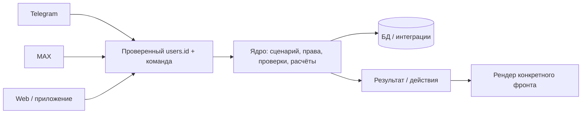

# Требования к границе ядра и интерфейсов

Статус: обязательный архитектурный контракт. Дата: 28.10.2026.
Применяется к новым функциям и изменениям существующих сценариев FIINOPS.
Реализация и проверка контракта входят в критерии готовности изменения.

## Определения

**Ядро** — общий Python-код бизнес-операций и прикладных сценариев. Оно принимает
внутренний `users.id`, параметры команды и обычные данные; проверяет актуальные
права, компанию, состояние и значения; выполняет расчёты и транзакции; возвращает
результат и допустимые действия. Оно работает без Telegram, MAX и HTTP-сервера.

**Фронты / интерфейсные адаптеры** — Telegram-бот, MAX-бот, HTTP-обработчики
панели и Mini App, будущие приложения. Они проверяют подлинность события/сессии,
разрешают внешнюю идентичность в `users.id`, декодируют ввод в команду,
скачивают/отправляют файлы, отображают результат и создают кнопки своей платформы.
Фронт не является источником истины о правах, остатках или допустимости операции.

Независимость ядра не требует отдельного API, процесса, контейнера или БД.
Процессы фронтов импортируют одну версию общего кода и используют одну БД.

## Нормативные требования

| ID | Требование | Проверка |
|---|---|---|
| BND-01 | `app/services`, `app/application`, `app/schemas` не импортируют интерфейсные пакеты или SDK | AST и запуск импорта ядра с запрещёнными SDK |
| BND-02 | Ядро не принимает `Message`, `CallbackQuery`, `Bot`, HTTP Request, MAX update или объекты UI | Отсутствие SDK в зависимостях; проверка контрактов функций при ревью |
| BND-03 | Бизнес-команды используют `users.id`, не Telegram/MAX ID | Канонические сервисы; тесты MAX-only и проверки разделения фасадов |
| BND-04 | Каждое изменение прав, компании, статуса, денег и документа проверяется серверным общим сервисом | Интеграции ролей, чужих IDs, отключения и перевода компании |
| BND-05 | Бизнес-расчёты, правила и последовательности действий не копируются в разные фронты | Одни команды/сервисы и тесты одинаковых результатов |
| BND-06 | SQL и получение соединений БД отсутствуют во фронтах | AST-проверка импортов и SQL-вызовов |
| BND-07 | Многошаговый бизнес-ввод хранится по `users.id`, с TTL, ревизией и привязкой к компании | `pending_inputs`, тесты ревизий/истечения/смены компании |
| BND-08 | Финансовая операция и потребление её черновика фиксируются одной транзакцией | Тест rollback после записи до удаления ввода |
| BND-09 | Повторные/параллельные подтверждения не создают вторую выплату, возврат или карту | Идемпотентность сервисов и интеграционные гонки |
| BND-10 | Ошибка формата или записи не поглощает действующий ввод | Проверки повторного ввода и rollback |
| BND-11 | Внешняя долгая работа выполняется без удержания финансовой транзакции; доступ проверяется повторно | Голос/OCR, тесты смены компании и отключения |
| BND-12 | Возврат результата не требует SDK; UI-объекты создаёт адаптер | DTO/обычные Python-значения, тесты рендера |
| BND-13 | Telegram-совместимые сигнатуры изолированы в `app/adapters/telegram`; ядро их не импортирует | AST, отсутствие `save_document` и регистрации SDK-пользователя в доменных классах |
| BND-14 | Изменение правила для нескольких фронтов делается в одном общем сценарии | Ревью изменения и регрессионные тесты общего вызова |
| BND-15 | Новый фронт не получает дополнительных полномочий из-за имени платформы, кнопок или переданного company_id | Подлинность отправителя в адаптере; повторная проверка в ядре |

Статические тесты проверяют зависимости и прямые SQL-вызовы. Они не доказывают
автоматически правильность любой произвольной бизнес-логики: соответствие BND-02,
BND-05 и BND-14 дополнительно оценивается при ревью сценария.

## Распределение ответственности

| Область | Ядро | Фронт |
|---|---|---|
| Команда возврата денег | Кто может вернуть, какая выдача, сумма, идемпотентность и запись | Прочитать текст/кнопку, вызвать команду, показать ответ |
| Карта | Проверка названия/последних цифр, роль, запрет хранения полного номера, запись | Форма и маскирование отображения |
| Отмена/отклонение | Допустимость статуса, причина, права и аудит | Поле ввода причины и подтверждение |
| Документ | OCR, структура, дубли, проверки, проект, сохранение | Файл платформы → ограниченные bytes; кнопки и отправка результата |
| ИИ-запрос | Голос → текст → параметры, контекст, выбор сущностей, расчёт, доступ | Скачивание аудио, передача вопроса, рендер выбора и ответа |
| Навигация | Изменение/завершение прикладного состояния | Событие кнопки → вызов команды навигации |
| Отчёт | Границы дат, валюты, SQL, суммы, история и экспорт | Дата/фильтр формы, формат числа, график и отправка готового XLSX |
| Идентичность | Связи внешних аккаунтов, роли, состояние пользователя | Доверенный sender/session → вызов разрешения идентичности |

Фронт может скрывать или показывать кнопки по полученному состоянию и делать
предварительную проверку формата для удобства. Это не заменяет проверку в ядре.
Маска денег, локализация даты и раскладка клавиатуры — представление; расчёт
учтённых расходов, задолженности, итогов и правил периода — ядро.

## Каталоги и разрешённые зависимости

- `app/application/` — общие команды, сценарии, результаты и нейтральные действия.
- `app/services/` — операции, авторизация, хранение, SQL, интеграции провайдеров и
  SDK-независимая инфраструктура доставки/идентичности.
- `app/schemas/` — общие структуры данных.
- `app/handlers/`, `app/adapters/telegram/`, `app/max_bot/`, `app/web/`, `app/ui/` —
  интерфейсные границы. `app/state/` содержит только совместимые Telegram-обёртки
  или локальную сериализацию событий; новое бизнес-состояние туда не добавляется.

Направление зависимости: **фронт → application/services → schemas/storage**.
Обратное направление запрещено, включая импорты внутри функций.

Есть два узких разрешённых случая, которые не являются бизнес-командами:

1. Интеграции идентичности (`account_links`, `telegram_registration`,
   `max_onboarding`, `telegram_mini_auth`, `web_auth`, bootstrap owner) по своей
   задаче принимают внешние IDs или подписанные строки/байты. Они не принимают
   объекты SDK. Внешние IDs допустимы также как адрес доставки или отображаемые
   метаданные; ими нельзя подменять `users.id` в финансовой операции.
2. Точки запуска могут вызывать `init_db`/`close_db` для жизненного цикла сервиса.
   Получать пул и выполнять SQL во фронте запрещено. Состояние poller и очередей
   уведомлений хранится через `services/max_delivery.py` и соответствующие сервисы.

Нейтральное форматирование и описание действий могут находиться в общем слое.
Они не создают клавиатуры aiogram, MAX JSON или HTTP Response. Существующие строки
callback — совместимые коды навигации, а не источник разрешений.

## Контракты текущих сценариев

- `FinancialInputs.start(actor, action, payload)` → запрос ввода.
- `FinancialInputs.submit(actor, text, revision)` → результат операции;
  операция и завершение ввода атомарны.
- `WorkspaceCommands.execute/input`, `IssueCommands.apply`, `DocumentFlow`,
  `AIReportCommands.question/voice/choose/enter/exit/navigate` — общий сценарный слой.
- `CompanyDirectory`, `ProjectDirectory`, `DocumentService.save_for_user`,
  `ReportService`, `AdvanceService`, `BusinessCardService` — канонические операции.

Готовая веб-форма может передать все поля сразу в общий сервис операции, не
воспроизводя диалог бота. Отсутствие экрана в MAX не означает отсутствие операции
в ядре и не требует копирования реализации из Telegram.

## Миграция и приёмка

Миграция 024 переводит оставшийся `pending_actions` на `actor_id`/`company_id`.
Старое `telegram_user_id` оставлено nullable только для проверки старых данных;
новый код его не использует для владения вводом. Неразрешимые устаревшие
черновики удаляются; документы, выплаты и финансовая история сохраняются.

Перед обновлением: backup, сборка новой версии, остановка старых Telegram/MAX
и работающей панели, запуск всех используемых процессов одной версии.
Смешивать старый писатель ввода с новой схемой нельзя. Сброс БД не требуется.

Приёмка изменения требует:

1. Прохождения `tests/test_core_boundaries.py` и соответствующих тестов сценария.
2. PostgreSQL-интеграций с `RUN_DATABASE_TESTS=1` на отдельных временных БД.
3. Проверки старых/чужих кнопок, отзыва прав, повторов и rollback для изменения
   финансового сценария.
4. Обновления этого документа при изменении границы и объяснения новой зависимости.

Добавление ещё одного SDK в ядро или второй реализации правила во фронте не
считается завершённым решением, даже если кнопка работает и функциональный тест зелёный.

Проверено в этой ветке: полный набор — 418 тестов успешно; профильный контракт — 13 тестов успешно.
Внешние OCR/LLM подменены; состояние живого VPS этим не подтверждается.
