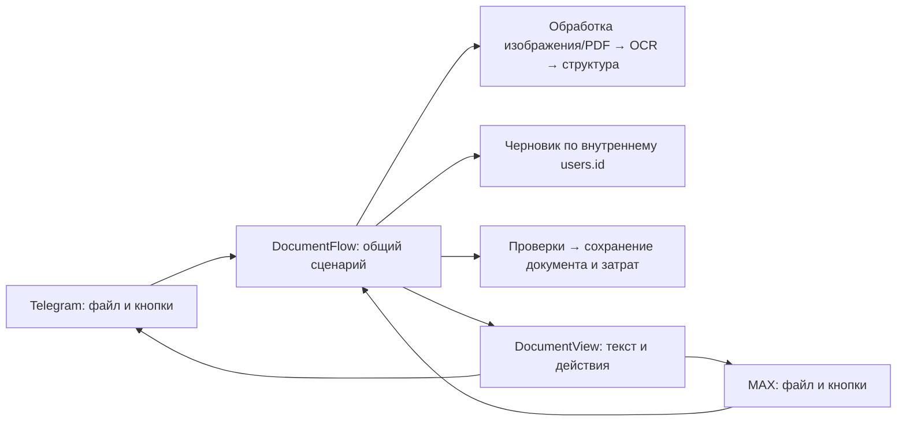

# Общее ядро документов

Telegram и MAX используют один `DocumentFlow`. В ядро передаются внутренний
`users.id`, пространство событий (`telegram`, `max`, `web`), ID события,
тип документа (`photo`/`pdf`), подпись и асинхронная функция получения байтов.
Объекты Telegram/MAX, ссылки CDN, токены ботов и внешние ID пользователей в ядро
не передаются. Адаптер отвечает за аутентификацию отправителя и доставку сообщений.

## Границы

- `services/document_flow.py`: права и компания, единственная текущая загрузка
  профиля, повторная доставка, предпросмотр, проекты, создание проекта в процессе,
  отмена, проверка дублей/сумм, сохранение и повторные нажатия.
- `services/document_processing.py`: лимиты, подготовка изображения, страницы PDF,
  OCR с существующим повтором для тайм-аута/E101, извлечение структуры и проверка
  разрешённого типа документа. Провайдер выбирается из общих настроек пользователя.
- `services/pdf_files.py`, `image_files.py`: общая подготовка файлов. PDF остаётся
  JPEG с длинной стороной 1800 px и качеством 88, максимум 10 МБ/10 страниц.
  Фото/скан — JPEG/PNG/WebP, максимум 20 МБ; подготовка изображения как ранее.
- `services/documents.py`: канонические `save_for_user` и `find_duplicate_for_user`
  принимают внутренний ID. Старые Telegram-методы находятся в `app/adapters/telegram/documents.py`
  как совместимый фасад:
  они разрешают внешнюю идентичность и делегируют этим же методам.
- `services/document_drafts.py`: PostgreSQL-черновики по внутреннему ID. Старый
  `state/pending_documents.py` — только Telegram-адаптер к этому хранилищу.
- `handlers/documents.py`: загрузка байтов через Telegram API и преобразование
  `DocumentView` в сообщения/inline-кнопки. OCR и бизнес-проверок в обработчике нет.
- `max_bot/documents.py`, `files.py`: вложения MAX и callback-кнопки. CDN скачивается
  отдельным HTTP-клиентом без Authorization бота, с лимитом потока, проверкой HTTPS
  и публичного адреса каждого перенаправления. URL и имена файлов не журналируются.

Принимать приглашение и иметь Telegram ID для загрузки через MAX не требуется,
если пользователь уже состоит в компании через MAX. Настройки провайдеров читаются
без инициализации Telegram SDK или конфигурации его API.

## Правила состояния и сохранения

Один профиль имеет один незавершённый документ для обоих мессенджеров. Готовый
черновик живёт 15 минут и переживает перезапуск. Продолжить его можно во втором
привязанном мессенджере; старые кнопки не изменяют новую загрузку.

После перезапуска посреди OCR незавершённая обработка требует отмены и повторной
отправки файла: исходные URL/файлы для фонового повтора не сохраняются. В текущем
тестовом MAX Long Polling распознавание выполняется последовательно с событиями;
отдельная очередь фоновых заданий в этот этап не входит.

Права, компания и доступность проекта проверяются повторно. Обработка провайдером
происходит без долгой блокировки компании; перед сохранением проверяется актуальный
доступ. Сохранение документа/товаров/затрат и удаление черновика атомарны.
Повтор события/нажатия возвращает уже сохранённый результат без второй записи;
повтор доставленного вложения не запускает готовый OCR заново.

Дубли ищутся по истории всей компании, включая архивные проекты. Требуется явное
решение «Все равно добавить». Подтверждение арифметической проверки не обходит
решение по дублю. После сохранения дубль помечен, но остаётся затратой.
Источники оплаты и денежные расчёты не изменены.

## Обновление

Миграция `022_canonical_document_flows.sql` переводит существующие живые
Telegram-черновики на внутренние ID и добавляет ключи доставки вложений.
Черновики незарегистрированных идентичностей удаляются как недоступные;
документы, товары, деньги и членство не меняются. Сделайте резервную копию базы
и обновите **оба** контейнера Telegram/MAX вместе: старый процесс обращается
к прежнему полю хранилища. После обновления проверьте фото и PDF на тестовом боте.

Тесты проверяют отсутствие импорта Telegram SDK в ядре, MAX без Telegram ID,
оба адаптера, реальный PDF-рендер и очистку временных файлов, выбор провайдера,
повторы, перезапуск, миграцию живого черновика, архивные дубли, арифметическую
проверку, чужие проекты/кнопки, отзыв доступа, откат и сохранение денежных отчётов.
Внешние OCR/LLM в автотестах заменены ответами провайдеров; реальные API/бот на VPS
этим тестовым прогоном не проверялись.
